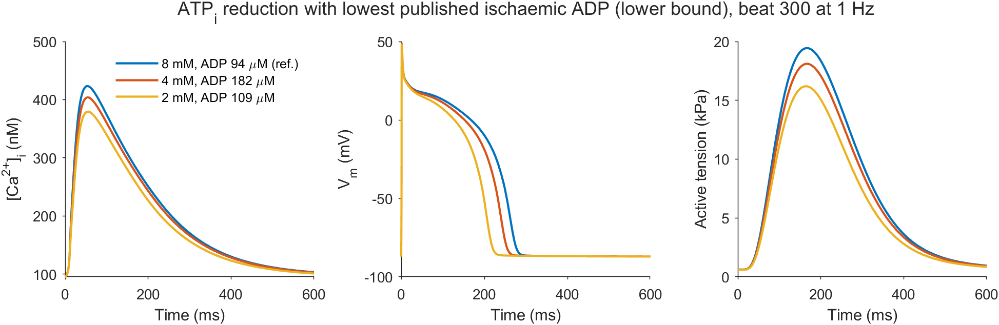
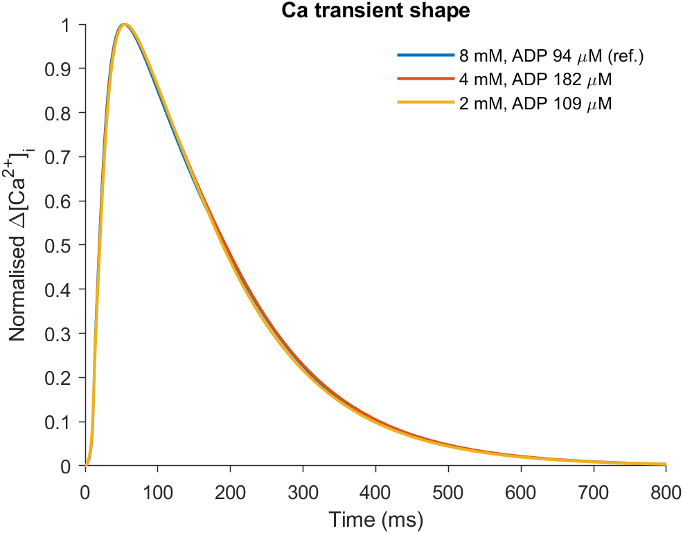
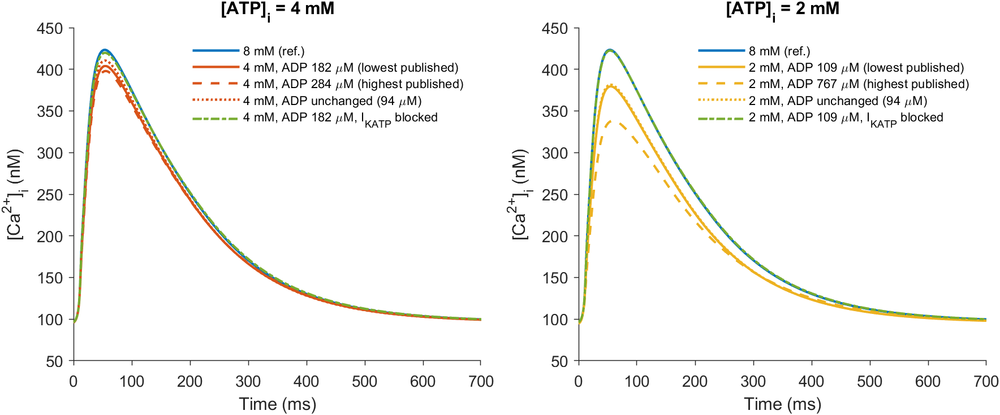
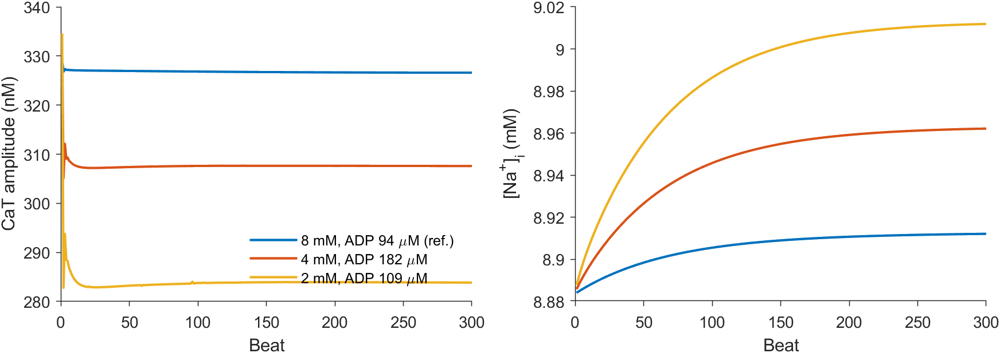
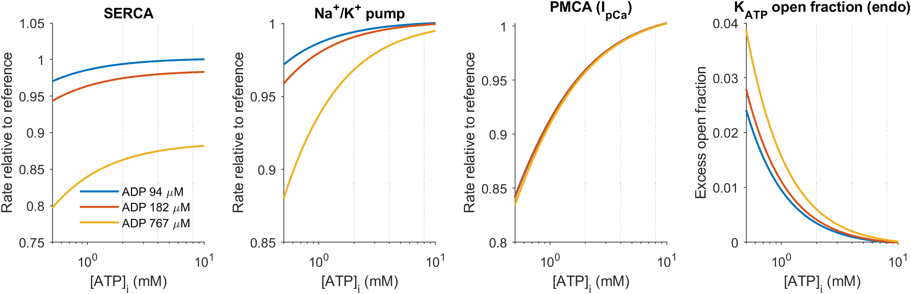
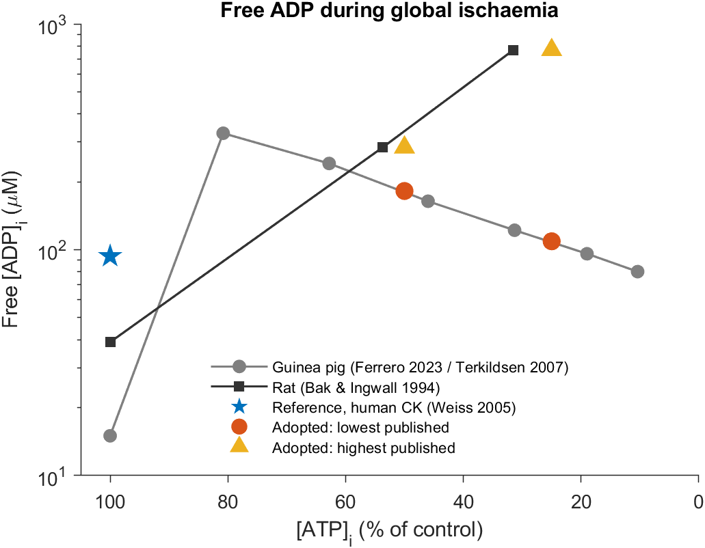
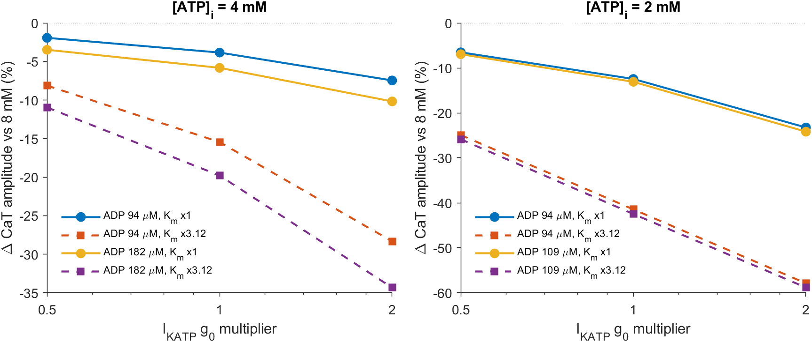
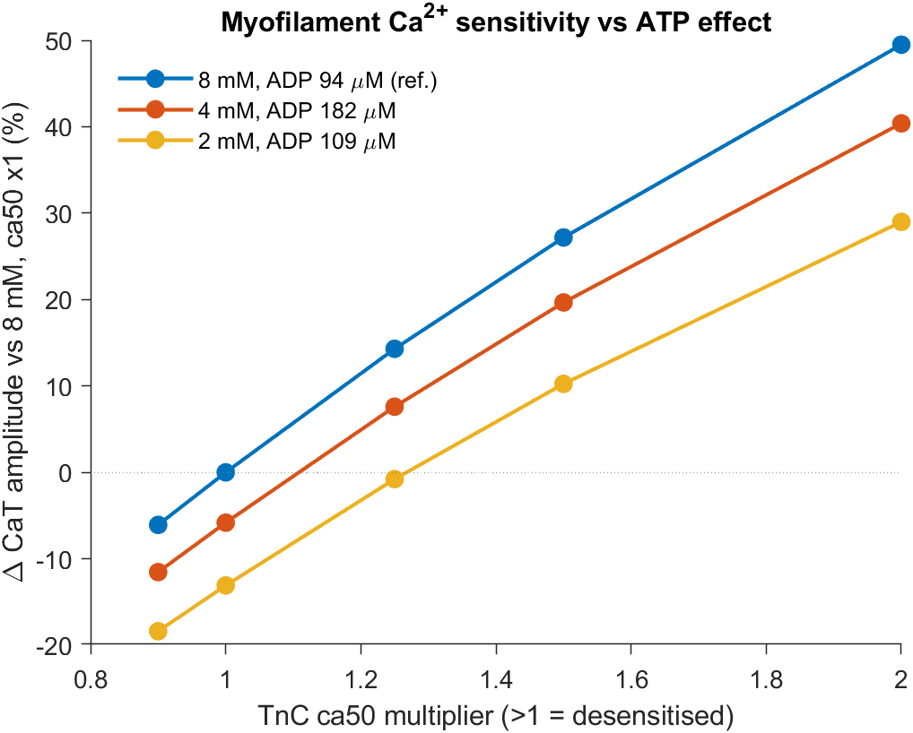

# Reduced intracellular ATP and the Ca²⁺ transient in T-World: a lower bound

**Question.** When cytosolic [ATP] falls from a saturating 8 mM to 4 or 2 mM, what is the
*smallest* change in the Ca²⁺ transient (CaT) of the T-World human endocardial myocyte that
current data and the current model support?

**Approach.** Every uncertain parameter is set in the direction that *reduces* the effect.
Mechanisms that would only enlarge it are left out but listed. The one well-documented
mechanism that acts in the opposite direction, myofilament desensitisation by acidosis, is
reported separately (§5) rather than folded into the bound.

- Analysis script: [`runLowATPAnalysis.m`](runLowATPAnalysis.m). It writes
  [`results.csv`](results.csv), `results_summary.mat` and `figures/`.
- Model changes (branch `lowAtp`):
  - [`model_TWorld.m`](../../model_TWorld.m)
  - [`getDefaultParameters.m`](../../getDefaultParameters.m)
  - [`getCKEquilibriumADP.m`](../../getCKEquilibriumADP.m)
  - [`modelRunner.m`](../../modelRunner.m)
  - [`getCurrentsStructure.m`](../../getCurrentsStructure.m)
  - [`sampleScript_11_ATPdependence.m`](../../sampleScript_11_ATPdependence.m)

This version replaces an earlier write-up, which used an assumed creatine pool, a CK-derived
ischaemic ADP and ADP_ref = 39 µM. It addresses an internal peer review (major revision) and
an independent primary-literature check of every parameter (Claude Science, 2026-10-27).
Both are summarised in §8.

## Summary: lower bound

These are endocardial cell results at 1 Hz, with ATP and free ADP clamped. Changes are
relative to 8 mM ATP at matched myofilament Ca²⁺ sensitivity.

| | 8 → 4 mM ATP | 8 → 2 mM ATP |
|---|---|---|
| **CaT amplitude, lower bound** (lowest published ischaemic ADP, human K_ATP, endo α) | **−5.8 %** | **−13.1 %** |
| CaT amplitude if I_KATP is only half as strong (g₀ ×0.5) | −3.5 % | −7.0 % |
| CaT amplitude with I_KATP blocked (pumps only) | −1.1 % | −0.3 % |
| CaT amplitude, highest published ADP (upper end of data, not a bound) | −7.6 % | −25.5 % |
| APD₉₀, lower-bound scenario | −8.2 % | −21.0 % |
| Peak active tension, lower-bound scenario | −6.9 % | −16.7 % |
| CaT decay τ, lower-bound scenario | +0.4 % | −3.8 % |

1. **The minimal ATP-attributable CaT reduction is about 6 % at 4 mM and 13 % at 2 mM.**
   - Nearly all of it is electrical. Excess K_ATP opening of only 0.13 % (4 mM) and 0.36 %
     (2 mM) shortens the AP. That reduces L-type Ca²⁺ entry and, slightly, SR load.
   - The ratio to the 8 mM transient is the same within 0.3 percentage points (pp) at 4 mM
     and 0.6 pp at 2 mM across a 0.9–2× range of TnC Ca²⁺ affinity (Fig. 8).
2. **The direct ATP/ADP effect on the pumps is negligible (≤1 %).** With the Cortassa et
   al. (2006) kinetics, SERCA, the Na⁺/K⁺ pump and PMCA stay above 96 % of their reference
   rate at published ischaemic ADP.
   - If I_KATP were absent or fully blocked, the guaranteed effect on the CaT would be
     ≈1 %.
   - The bound therefore rests on K_ATP channels being present and gated as in human
     recombinant channels (Babenko et al. 1998). This is the single most important
     assumption.
3. **CaT decay kinetics do not give a robust signature of low ATP.**
   - τ changes by −4 % to +2 % across the base scenarios.
   - A 25 % change in TnC affinity alters τ by 13 % (Fig. 8).
   - In real ischaemia, any change in decay rate is therefore more likely myofilament- or
     pH-driven than ATP-driven.
4. **Myofilament Ca²⁺ sensitivity can mask the effect.**
   - Acidosis lowers TnC Ca²⁺ affinity. Ca²⁺ then unbinds from TnC, which raises the free
     CaT.
   - Desensitisation by ca50 ×1.1 (4 mM) or ×1.27 (2 mM) cancels the ATP-attributable
     reduction in absolute amplitude (Fig. 8).
   - Measured ischaemic pH shifts are larger than this (§5). The observable absolute CaT
     can therefore rise during ischaemia, even though the ATP component is a reduction.
   - Nucleotide-driven sensitisation (low MgATP, high MgADP) works the other way and is
     left out. Including it would enlarge the reduction.

## 1. Reference state and exact baseline

All nucleotide effects are expressed relative to a reference state, ATP_ref = 8 mM and
ADP_ref = 93.7 µM (§3).

- Each pump factor is divided by its value at the reference state. In IEEE arithmetic
  `x/x == 1` exactly.
- K_ATP contributes only the open fraction *in excess* of the reference,
  `max(0, (f_o − f_o,ref)/(1 − f_o,ref))`. This is exactly 0 at reference.
- So at the reference state every multiplier is exactly 1 and I_KATP is exactly 0. The
  outputs are bitwise identical to the original T-World for the endo, epi and mid cell
  types (checked with `isequal` on the full state trajectory).
- The justification is that T-World's maximal rates were calibrated to healthy human data,
  i.e. near-saturating energetics. Any resting K_ATP conductance is absorbed in the
  calibrated background K⁺ currents (endo f_o,ref ≈ 0.07 %).

## 2. SERCA, Na⁺/K⁺ pump and sarcolemmal Ca²⁺ pump (Cortassa et al. 2006)

These equations and constants were checked against the paper's appendix (Eqs. A35, A46,
A50; Tables 3, 6, 7) and the CellML encoding.

| Component | Factor (ATP, ADP in mM) | Constants |
|---|---|---|
| SERCA (V_max of forward and reverse flux) | 1 / [K_m/ATP·(1 + ADP/K_i) + 1 + ADP/K_i′] | K_m = 0.01, K_i = 0.14, K_i′ = 5.1 |
| Na⁺/K⁺ pump (I_NaK) | 1 / [1 + K_m/ATP·(1 + ADP/K_i)] | K_m = 0.008, K_i = 0.1 |
| PMCA (I_pCa) | 1/[1 + K_m1/ATP·(1 + ADP/K_i)] + 1/[1 + K_m2/ATP] | K_m1 = 0.012, K_i = 1.0, K_m2 = 0.23 |

- **PMCA normalisation.** The PMCA factor is a *sum* with maximum 2. It is normalised to
  the reference, so I_pCa is not doubled.
- **Free vs total ADP.** Cortassa's ADP is *total* ADP (C_A − ATP, with C_A = 8 mM). Here
  *free* ADP is used, for two reasons:
  - the constants come from in-vitro enzyme work, where the enzyme sees free (Mg)ADP;
  - total ADP would be mM-level at 4 mM ATP. That would *increase* product inhibition, so
    free ADP is the conservative choice.
- **Cross-species constants.** The K_m values are guinea-pig/rat in-vitro values.
  - For the Na⁺/K⁺ pump in ventricular patches, Friedrich et al. (1996) found K_m(ATP)
    ≈ 150 µM. That was in rat/guinea pig at 24 °C, not human at 37 °C.
  - Even with that K_m, the pump would stay above 95 % of its rate at 2 mM ATP. The
    conclusion that the pumps contribute ≤1 % does not depend on which constant is used.
- **Pi is not modelled.** The thermodynamic Pi/ADP limit on the SERCA gradient (Tran et
  al. 2009) would *increase* the effect; see §7.

## 3. Free ADP: reference and published ischaemic values

**Reference.** Free ADP comes from the creatine kinase (CK) equilibrium for healthy human
LV (Weiss et al. 2005), with K_CK = 1.66·10⁹ M⁻¹ (Lawson & Veech 1979):

[ADP] = [ATP]·[Cr] / (K_CK·[H⁺]·[PCr])

- Inputs: PCr/ATP = 10.1/5.7 and total creatine/ATP = 27.6/5.7 (µmol/g wet weight), pH
  7.05. This uses a pH slope of 1, as Weiss et al. do.
- At 8 mM ATP this gives PCr = 14.2 mM, Cr = 24.6 mM and **ADP_ref = 93.7 µM**. Weiss et
  al. report ≈ 92 µM.
- This replaces the earlier 39 µM, which used an unsupported PCr/total creatine of 0.6;
  the human value is 0.37.
- A *high* ADP_ref is effect-reducing. It raises the reference K_ATP open fraction and the
  reference pump inhibition, so a given ischaemic state differs less from reference. The
  animal normoxic values are lower: 15 µM in guinea pig (Ferrero et al. 2023) and 39 µM in
  rat (Bak & Ingwall 1994).

**Reduced ATP.** The CK equilibrium is not used to *predict* ischaemic ADP.
- PCr is exhausted before ATP falls to 50 %: undetectable at 8 min in rat (Bak & Ingwall
  1994) and about 2 % at 15 min in guinea pig (Sakamoto et al. 2000).
- With PCr near zero the equation is ill-conditioned. Published free ADP values are used
  instead (Fig. 6):

| Source | ATP | Free ADP | Notes |
|---|---|---|---|
| Guinea pig (Ferrero et al. 2023 Fig. 1, digitised; Terkildsen et al. 2007 profile from Befroy et al. 1999 data) | 10 → 8.08 → 6.28 → 4.60 → 3.13 → 1.90 → 1.04 mM (0–30 min) | 15 → 328 → 241 → 164 → 122 → 96 → 80 µM | 37 °C, free ADP; ±5 µM digitising error |
| Rat (Bak & Ingwall 1994, Table II) | 10.8 → 5.8 (8 min) → 3.4 mM (12 min) | 39 → 284 → 767 µM | CK-calculated; pH 6.38/6.24; Pi 21.5/26.5 mM |

**Adopted values.** ATP is mapped as a fraction of control, so 4 mM = 50 % and 2 mM = 25 %.
- **Lower bound (ADPmin):** the lowest published ADP at that ATP fraction. That is guinea
  pig, interpolated: **182 µM at 50 %** and **109 µM at 25 %**.
- **Upper end (ADPmax):** rat, 284 µM at 54 % and 767 µM at 31 %. The authors flag these
  as semi-quantitative at acidic pH. The 31 % point is assigned to 25 %.
- **Sensitivity check.** Keeping ADP at 94 µM gives −3.8 % (4 mM) and −12.5 % (2 mM). At
  4 mM this is lower than the bound, but no dataset shows ADP staying at the normoxic level
  once PCr is gone. This scenario is shown for dissection only.

## 4. ATP-sensitive K⁺ current: human formulation and strength band

The human formulation is that of Mena Tobar, Ferrero & Rodriguez Matas (CinC 2015, Eq. 4
and Table 1), built on Ferrero et al. (1996):

I_KATP = g₀·(K_o/5.4)^0.24·f_ATP·f_M·f_N·f_T·(V − E_K)

- **ATP gating:** f_ATP = 1/(1 + ([ATP]/K_m)^H).
  - K_m = α·(35.8 + 17.9·[ADP]^0.256) µM and H = 1.3 + 4.44·e^(−0.09·[ADP]), with
    concentrations in µM (confirmed in the CinC text).
  - α = 0.32 (endo), 0.86 (mid), 1.0 (epi). g₀ = 4.5, with the unit printed as "mS";
    mS/µF is inferred.
  - Endo is the *least* sensitive cell type, so using it is effect-reducing.
- **Human data check (Babenko et al. 1998, human Kir6.2/SUR2A).** IC₅₀(ATP) ≈ 20 µM,
  pseudo-Hill ≈ 1.
  - The endo K_m is 30 µM at 94–109 µM ADP and 12 µM without ADP.
  - At mM ATP, H = 1.3 gives *fewer* open channels than Hill 1. Using H = 1.3 is therefore
    conservative.
- **Strength check (Ferrero et al. 1996).** About 0.6 % open K_ATP channels gave a 50 %
  APD shortening in the Luo–Rudy guinea-pig model. In T-World, 0.36 % excess opening gives
  21 %. Even scaled linearly, the T-World response is not stronger than Ferrero's. There
  is no evidence that g₀ = 4.5 overstates the current.
- **Block and temperature terms.** f_M (Mg²⁺ block), f_N (Na⁺ block, junctional and
  subsarcolemmal separately) and f_T (Q₁₀ = 1.3) follow Ferrero et al. (1996). They are
  quoted from secondary sources; the original constants could not be verified.

**Strength band (Fig. 7).** The g₀ × K_m multipliers were swept over {0.5, 1, 2} × {1,
3.125}. The K_m ×3.125 setting corresponds to α_epi/α_endo.
- g₀ ×0.5 has no literature basis. It is included because two known factors could make
  I_KATP weaker than modelled:
  - transferring the TP06-fitted g₀ to T-World;
  - the rise in free Mg²⁺ as MgATP falls, which strengthens the Mg²⁺ block. This is not
    modelled; [Mg]_i is fixed at 0.5 mM.
- Even then, the CaT falls by 3.5 % (4 mM) and 7.0 % (2 mM).
- Epicardial-like sensitivity gives up to −20 % and −42 %.

## 5. Myofilament Ca²⁺ sensitivity (reviewer issue 3)

In T-World's Land model, only the TnC Ca²⁺ affinity (ca50) feeds back on the free CaT, via
TnC buffering (B_max = 70 µM).
- About 24 µM Ca²⁺ is TnC-bound at the CaT peak, against about 0.33 µM free. Small
  affinity changes therefore move the free transient a lot.
- Cross-bridge and force effects of Pi do not feed back on Ca²⁺ in this model.

A new parameter `ca50_Multiplier` was added; it equals 1 by default, so the baseline is
unchanged. ca50 was swept over 0.9–2 at 8, 4 and 2 mM ATP (Fig. 8):

| ca50 × | 8 mM CaT (nM) | 4 mM vs 8 mM | 2 mM vs 8 mM | τ at 8 mM (ms) |
|---|---|---|---|---|
| 0.9 | 306.7 | −5.8 % | −13.1 % | 173.6 |
| 1.0 | 326.6 | −5.8 % | −13.1 % | 161.9 |
| 1.25 | 373.3 | −5.9 % | −13.2 % | 140.2 |
| 1.5 | 415.4 | −5.9 % | −13.3 % | 126.3 |
| 2.0 | 488.2 | −6.1 % | −13.7 % | 108.0 |

- **The ATP-attributable relative effect hardly depends on TnC affinity.** Myofilament
  sensitivity and ATP act almost independently on the CaT.
- **The absolute CaT depends strongly on TnC affinity.** ca50 ×1.25 raises it by 14 % and
  shortens τ by 13 %.
- **Literature directions** (all [A]):
  - Acidosis desensitises the myofilaments and lowers TnC Ca²⁺ affinity. Skinned cardiac
    pCa₅₀ falls by about 1 unit from pH 7.0 to 6.2 (Palmer & Kentish 1994). This is far
    more than the ×1.1–1.3 ca50 needed to offset the ATP effect. How much of the force
    shift is TnC affinity is not known here, so this is direction only.
  - Pi lowers force pCa₅₀ by about 0.2 but does not change the Ca²⁺ affinity of isolated
    TnC, so it should have little effect on the free CaT (Palmer & Kentish 1994).
  - Low MgATP and high MgADP *sensitise* the myofilaments, and MgADP partly restores the
    sensitivity lost under simulated ischaemia (Papp et al. 2002). Sensitisation would
    *enlarge* the CaT reduction. It is omitted, which keeps the bound conservative.
- **Consequence.** The bound applies to a comparison at matched myofilament sensitivity,
  e.g. matched pH. In an acidotic ischaemic cell, the net observable CaT may be unchanged
  or larger. The ATP component is still a reduction of at least the bound.

## 6. Protocol and metrics

- Endocardial cell at 1 Hz, starting from the T-World endo initial state. Nucleotides are
  clamped from beat 1, so this is a quasi-steady response to an energetic state, not an
  ischaemic time course.
- Base scenarios ran for 300 beats and sweeps for 150 beats; the last beat is analysed.
  - CaT amplitude is stable after about 50 beats (Fig. 4).
  - [Na⁺]_i is still drifting by about 0.1 mM at 2 mM ATP, because the Na⁺/K⁺ pump runs
    at 99 %. The resulting error in the CaT is well below the reported effects.
- **CaT metrics:**
  - amplitude (peak − diastolic) and time to peak;
  - τ, a single-exponential fit from 10 % decay to the end of the beat;
  - CaTD₅₀ and CaTD₉₀.
- **About the τ fit window** (reviewer minor point): the fit window includes the slow
  diastolic tail. CaTD₅₀ and CaTD₉₀ are model-free and are reported alongside τ; both
  agree that decay is barely affected in the lower-bound scenarios (CaTD₉₀ +0.6 % and −1.4 %, τ +0.4 % and −3.8 %).

## 7. Results

| Scenario | ADP (µM) | f_SERCA | f_NaK | f_PMCA | Excess K_ATP open | CaT amp (nM) | τ (ms) | CaTD₉₀ (ms) | APD₉₀ (ms) | SR Ca max (mM) | Peak T_a (kPa) |
|---|---|---|---|---|---|---|---|---|---|---|---|
| 8 mM (reference) | 94 | 1 | 1 | 1 | 0 | 326.6 | 161.9 | 403.1 | 269.1 | 0.709 | 19.4 |
| **4 mM, lowest published ADP** | 182 | 0.980 | 0.996 | 0.986 | 0.13 % | **307.6 (−5.8 %)** | 162.5 | 405.6 | 246.9 (−8.2 %) | 0.706 | 18.1 (−6.9 %) |
| 4 mM, highest published ADP | 284 | 0.960 | 0.994 | 0.985 | 0.15 % | 301.6 (−7.6 %) | 164.9 | 410.6 | 243.6 (−9.5 %) | 0.704 | 17.8 (−8.7 %) |
| 4 mM, ADP unchanged (dissection) | 94 | 0.998 | 0.998 | 0.986 | 0.10 % | 314.1 (−3.8 %) | 160.7 | 401.1 | 251.3 (−6.6 %) | 0.707 | 18.5 (−4.8 %) |
| 4 mM, lowest ADP, I_KATP blocked | 182 | 0.980 | 0.996 | 0.986 | – | 323.0 (−1.1 %) | 165.1 | 408.7 | 269.0 (0.0 %) | 0.708 | 19.3 (−0.8 %) |
| **2 mM, lowest published ADP** | 109 | 0.990 | 0.994 | 0.959 | 0.36 % | **283.9 (−13.1 %)** | 155.7 | 397.4 | 212.5 (−21.0 %) | 0.701 | 16.2 (−16.7 %) |
| 2 mM, highest published ADP | 767 | 0.863 | 0.968 | 0.957 | 0.60 % | 243.2 (−25.5 %) | 164.1 | 429.8 | 183.5 (−31.8 %) | 0.691 | 13.6 (−30.2 %) |
| 2 mM, ADP unchanged (dissection) | 94 | 0.994 | 0.994 | 0.959 | 0.35 % | 285.9 (−12.5 %) | 156.0 | 396.9 | 214.5 (−20.3 %) | 0.701 | 16.3 (−16.0 %) |
| 2 mM, lowest ADP, I_KATP blocked | 109 | 0.990 | 0.994 | 0.959 | – | 325.7 (−0.3 %) | 163.0 | 405.8 | 269.0 (0.0 %) | 0.709 | 19.4 (0.0 %) |

K_ATP strength band, CaT amplitude change vs 8 mM (150 beats):

| | g₀ ×0.5 | g₀ ×1 | g₀ ×2 | g₀ ×0.5, K_m ×3.1 | g₀ ×1, K_m ×3.1 | g₀ ×2, K_m ×3.1 |
|---|---|---|---|---|---|---|
| 4 mM, ADP 182 µM | −3.5 % | −5.8 % | −10.2 % | −11.0 % | −19.8 % | −34.3 % |
| 2 mM, ADP 109 µM | −7.0 % | −13.1 % | −24.2 % | −25.9 % | −42.5 % | −58.8 % |

All metrics, including time to peak, CaTD₅₀, resting V_m, [Na⁺]_i and peak I_KATP, are in
[`results.csv`](results.csv).



**Fig. 1.** CaT, action potential and active tension at 8, 4 and 2 mM ATP (lowest
published ADP, beat 300).



**Fig. 2.** Normalised CaTs. Rise and decay kinetics are nearly unchanged; the difference
is in amplitude.



**Fig. 3.** Mechanism dissection.
- Blocking I_KATP (dash-dot) restores the control transient.
- The lowest (solid) and highest (dashed) published ADP bracket the data.
- ADP held at the reference value (dotted) is shown for dissection only.



**Fig. 4.** Beat-to-beat CaT amplitude and [Na⁺]_i over 5 min of pacing.



**Fig. 5.** Normalised pump rates and excess K_ATP open fraction (endo) against [ATP]_i, for
the reference, lowest and highest ADP used.



**Fig. 6.** Published free ADP during global ischaemia and the values adopted. The rat
points are at 54 % and 31 % ATP; they are assigned to 50 % and 25 %.



**Fig. 7.** CaT amplitude change as a function of I_KATP g₀ and K_m (α) multipliers.



**Fig. 8.** TnC ca50 sweep. The vertical gap between curves (the ATP effect) is nearly
constant. Desensitisation (ca50 > 1) raises all transients and can offset the ATP effect in
absolute terms.

## 8. Review and literature check: what changed and why

**Peer review: major revision, not rejected.** Response to the major issues:

1. *Vary g₀ and α; endo α deflates the effect.*
   - **Fixed.** The strength band is added (§4, Fig. 7).
   - Endo α is kept for the bound on purpose, since endo is the least sensitive cell type.
   - The Ferrero (1996) and Babenko (1998) checks show the nominal g₀ and H are not
     inflated.
2. *The I_KATP-blocked runs are a control, not the floor.*
   - **Agreed.** They are now labelled as a control.
   - The floor is the lowest-ADP scenario with human K_ATP. The pumps-only result (≈1 %)
     is reported as what holds *without* K_ATP.
3. *Myofilament Ca²⁺ sensitivity dominates TnC buffering.*
   - **Addressed** with the `ca50_Multiplier` parameter and sweep (§5).
   - The relative ATP effect is robust to ca50, but the absolute CaT is not. This is now
     a headline caveat.
4. *pH was used asymmetrically, only to lower ADP.*
   - **Fixed** by removing the pH-dependent CK prediction of ischaemic ADP. Published free
     ADP is used instead.
   - pH now enters only through the reference CK state (Weiss 2005) and as the documented
     masking effect via ca50.
5. *The Pi caveat was missing from the summary.*
   - **Fixed.** See §2 and the limitations below. Pi would enlarge the effect, so the
     bound stands.

**Minor points:**
- "More than doubles" was replaced by exact ratios.
- The τ fit window is explained (§6).
- The reason for the bitwise baseline is given (§1).
- Citations now carry verification status.
- It is stated explicitly that the K_ATP human parameters rest on a 4-page proceedings
  paper (CinC 2015).
- A falsification test was added (below).
- [Na⁺]_i drift was quantified (§6).

**Literature check (Claude Science).** Corrections adopted:

| Item | Before | Now | Effect on bound |
|---|---|---|---|
| Human PCr/total creatine | 0.6 (assumed) | 0.37 (Weiss 2005) | ADP_ref 39 → 94 µM; effect-reducing |
| CK pH slope | 0.87 (Stepanov 1997) | 1 (Lawson & Veech definition; Weiss 2005) | ≈3 % on ADP_ref |
| PCr at ATP 50 % / 25 % | 10 % / 5 % | ≈0–2 % / 0 % → CK ill-conditioned | Published ADP used instead |
| Ischaemic ADP | CK-derived 113 / 78 µM | Published 182–284 / 109–767 µM | |
| Ferrero 1996 APD anchor | "~1 % → 50 %" | ≈0.6 % → 50 % | Model is conservative |
| Babenko 1998 | not used | IC₅₀ ≈ 20 µM, Hill ≈ 1 (human) | Supports endo K_m and H as conservative |
| Cortassa ADP definition | unstated | Total ADP in Cortassa; free used here | Documented; conservative |
| PMCA factor | (normalised) | Confirmed to be a sum with max 2 | Normalisation required and in place |

**Not verifiable:**
- The Ferrero 1996 Mg²⁺/Na⁺ block and Q₁₀ constants (full text not accessed).
- The Terkildsen 2007 Na⁺/K⁺ pump K_d. This is not used here.
- Friedrich 1996 beyond the abstract.
- The pump scalings attributed to Ferrero 2023, which are not in that paper (probably in
  Carpio et al. 2022, not read).

## Limitations and what could move the bound

**Could make the effect smaller than the bound:**
- **K_ATP channels absent, down-regulated or blocked.** The effect then falls to ≈1 %.
  The human K_ATP gating rests on recombinant data (Babenko 1998) and a 4-page
  proceedings paper (Mena Tobar et al. 2015).
- **Rising free Mg²⁺ during ATP depletion** strengthens the K_ATP Mg²⁺ block (not
  modelled). This is partly covered by the g₀ ×0.5 band.
- **Transfer of g₀ and α from TP06 to T-World.** The APD response depends on T-World's
  repolarisation reserve.
- **Myofilament desensitisation** (acidosis) cancels the effect in *absolute* terms
  (§5). It does not change the ATP-attributable component.

**Would make the effect larger (omitted, so the bound is conservative):**
- Pi and the thermodynamic limit on SERCA (Tran et al. 2009). Ischaemic Pi is 21–27 mM
  (Bak & Ingwall 1994).
- Total instead of free ADP in the Cortassa factors.
- Nucleotide-driven myofilament sensitisation (MgADP; Papp et al. 2002).
- ATP activation of RyR2 (EC₅₀ ~0.2–1 mM; Meissner & Henderson 1987). Less ATP means less
  release.
- Mid or epi cell types (α 0.86–1.0).
- The highest published ADP.

**Not modelled at all:**
- extracellular K⁺ accumulation;
- direct effects of acidosis on channels and exchangers;
- L-type channel rundown;
- adenine nucleotide degradation kinetics;
- time-varying ischaemia (all states are clamped).

**Species.** All ischaemic ADP data are animal: guinea pig and rat. The only human input
is the normoxic reference.

**Falsification.**
- Test: in human ventricular myocytes dialysed with 2 mM vs 8 mM MgATP, with ADP ≈ 0.1 mM
  and pH and Mg²⁺ clamped.
- The model predicts a CaT amplitude reduction of at least about 7–13 % that is abolished
  by glibenclamide.
- No reduction, or a reduction insensitive to K_ATP block, would falsify the K_ATP route
  that the bound relies on.

## References

**Key:**
- **[S]** values read from the primary full text, appendix or model code (by us or the
  Claude Science check).
- **[A]** abstract only.
- **[R]** quoted from secondary sources, not verified.

- Babenko AP, Gonzalez G, Aguilar-Bryan L, Bryan J (1998) Reconstituted human cardiac
  K_ATP channels: functional identity with the native channels from the sarcolemma of human
  ventricular cells. *Circ Res* 83:1132–1143. doi:10.1161/01.RES.83.11.1132 [A]
- Bak MI, Ingwall JS (1994) Acidosis during ischemia promotes adenosine triphosphate
  resynthesis in postischemic rat heart. *J Clin Invest* 93:40–49. doi:10.1172/JCI116974
  [S, Table II]
- Cortassa S, Aon MA, O'Rourke B, Jacques R, Tseng HJ, Marbán E, Winslow RL (2006) A
  computational model integrating electrophysiology, contraction, and mitochondrial
  bioenergetics in the ventricular myocyte. *Biophys J* 91:1564–1589.
  doi:10.1529/biophysj.105.076174 [S, Appendix Eqs. A35, A46, A50; CellML workspace
  `andre/cortassa-ECME-2006`]
- Ferrero JM Jr, Sáiz J, Ferrero JM, Thakor NV (1996) Simulation of action potentials from
  metabolically impaired cardiac myocytes: role of ATP-sensitive K⁺ current. *Circ Res*
  79:208–221. doi:10.1161/01.RES.79.2.208 [A; Mg²⁺/Na⁺ block and Q₁₀ constants R]
- Ferrero JM, Gonzalez-Ascaso A, Rodriguez Matas JF (2023) The mechanisms of potassium loss
  in acute myocardial ischemia: new insights from computational simulations. *Front
  Physiol* 14:1074160. doi:10.3389/fphys.2023.1074160 [S, Fig. 1 digitised; no pump or
  K_ATP equations in the text]
- Friedrich T, Bamberg E, Nagel G (1996) Na⁺,K⁺-ATPase pump currents in giant excised
  patches activated by an ATP concentration jump. *Biophys J* 71:2486–2500 [A; rat/guinea
  pig, 24 °C]
- Lawson JW, Veech RL (1979) Effects of pH and free Mg²⁺ on the K_eq of the creatine kinase
  reaction and other phosphate hydrolyses and phosphate transfer reactions. *J Biol Chem*
  254:6528–6537 [A]
- Meissner G, Henderson JS (1987) Rapid calcium release from cardiac sarcoplasmic
  reticulum vesicles is dependent on Ca²⁺ and is modulated by Mg²⁺, adenine nucleotide,
  and calmodulin. *J Biol Chem* 262:3065–3073 [R]
- Mena Tobar A, Ferrero JM, Rodriguez Matas JF (2015) Sustained reentry in a 3D regionally
  ischemic human heart. A simulation study. *Computing in Cardiology* 42:645–648 [S, Eq. 4
  and Table 1]
- Nichols CG, Ripoll C, Lederer WJ (1991) ATP-sensitive potassium channel modulation of the
  guinea pig ventricular action potential and contraction. *Circ Res* 68:280–287.
  doi:10.1161/01.RES.68.1.280 [A; K½ 114 µM, guinea pig]
- Palmer S, Kentish JC (1994) The role of troponin C in modulating the Ca²⁺ sensitivity of
  mammalian skinned cardiac and skeletal muscle fibres. *J Physiol* 480:45–60 [A]
- Papp Z, Szabó Á, Barends JP, Stienen GJM (2002) The mechanism of the force enhancement by
  MgADP under simulated ischaemic conditions in rat cardiac myocytes. *J Physiol*
  543:177–189 [A]
- Sakamoto et al. (2000) *Jpn J Pharmacol* 83:225–229. doi:10.1254/jjp.83.225 [S, Figs. 4–6
  digitised by the Claude Science check; guinea-pig PCr and pH]
- Terkildsen JR, Crampin EJ, Smith NP (2007) The balance between inactivation and
  activation of the Na⁺-K⁺ pump underlies the triphasic accumulation of extracellular K⁺
  during myocardial ischemia. *Am J Physiol Heart Circ Physiol* 293:H3036–H3045.
  doi:10.1152/ajpheart.00771.2007 [A]
- Tran K, Smith NP, Loiselle DS, Crampin EJ (2009) A thermodynamic model of the cardiac
  sarcoplasmic/endoplasmic Ca²⁺ (SERCA) pump. *Biophys J* 96:2029–2042.
  doi:10.1016/j.bpj.2008.11.045 [S, CellML]
- Weiss RG, Gerstenblith G, Bottomley PA (2005) ATP flux through creatine kinase in the
  normal, stressed, and failing human heart. *PNAS* 102:808–813.
  doi:10.1073/pnas.0408962102 [S, Table 1 and Appendix]

## Reproducing

From MATLAB in this folder (R2023a was used; no toolboxes are needed):

```matlab
runLowATPAnalysis   % 9 base scenarios x 300 beats + 32 sweep scenarios x 150 beats
```

To use the extension elsewhere:

```matlab
param.ATP_i = 2;        % mM
param.ADP_i = 0.109;    % free ADP (mM): set from data; defaults to ADP_ref (93.7 uM)
param.IKATP_Multiplier = 1; param.KATP_Km_Multiplier = 1; param.ca50_Multiplier = 1;
```

With the defaults (ATP_i = ATP_ref = 8 mM, ADP_i = ADP_ref), the model is bitwise identical
to the original T-World.
