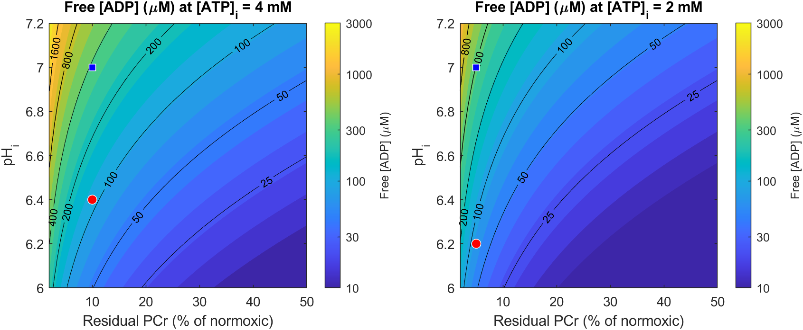

# Reduced intracellular ATP and the Ca²⁺ transient in T-World

How does lowering cytosolic [ATP] from a saturating 8 mM to 4 and 2 mM change the Ca²⁺
transient of the T-World human endocardial myocyte? Free [ADP] is estimated from the
creatine kinase (CK) equilibrium, with phosphocreatine (PCr) as the phosphagen buffer.

- Analysis script: [`runLowATPAnalysis.m`](runLowATPAnalysis.m). It writes
  [`results.csv`](results.csv), `results_summary.mat` and `figures/`.
- Model changes: [`model_TWorld.m`](../../model_TWorld.m),
  [`getDefaultParameters.m`](../../getDefaultParameters.m),
  [`getCKEquilibriumADP.m`](../../getCKEquilibriumADP.m),
  [`modelRunner.m`](../../modelRunner.m) and
  [`getCurrentsStructure.m`](../../getCurrentsStructure.m) (branch `lowAtp`).

## Summary

- **Direct effect on the pumps is small.** With the literature (Cortassa et al. 2006)
  nucleotide kinetics, SERCA, the Na⁺/K⁺ pump and PMCA are close to saturated at 2–4 mM
  ATP. Their rates fall by only 1–8 %, and slightly more when ADP is high.
- **The Ca²⁺ transient is reduced mainly through I_KATP.**
  - Partial opening of ATP-sensitive K⁺ channels shortens the AP: APD₉₀ falls 10 % at
    4 mM and 21 % at 2 mM in the ischaemic (acidotic) CK scenario.
  - The shorter AP lowers L-type Ca²⁺ entry and SR loading. CaT amplitude falls 6.5 %
    at 4 mM and 14 % at 2 mM; peak active tension falls 8 % and 17 %.
  - With I_KATP blocked, the CaT changes by ≤1 % at both ATP levels.
- **Ca²⁺ transient decay is almost unchanged.** τ changes by −4 % to +3 % in every
  scenario. Low ATP does not slow Ca²⁺ removal in this model, because SERCA's ATP site
  is high-affinity (µM).
- **Free ADP, set by PCr depletion and pH, is a major modifier.**
  - In the CK equilibrium, acidosis keeps ADP low: 78–113 µM at pH 6.2–6.4.
  - The same residual PCr at pH 7.0 gives about 380–390 µM ADP. That nearly doubles
    the effect (CaT amplitude −11 % at 4 mM, −22 % at 2 mM), because ADP raises the
    K_ATP Km and SERCA product inhibition.

## Mechanisms and values adopted

All nucleotide effects are normalised to a reference (saturating) state. At that state
(ATP_ref = 8 mM, ADP_ref = 39 µM) the model reproduces the original T-World exactly:
the outputs are bitwise identical for the endo, epi and mid cell types. The
justification is that the original T-World maximal rates were calibrated under
physiological, near-saturating energetics.

### 1. SERCA, Na⁺/K⁺ pump and sarcolemmal Ca²⁺ pump (Cortassa et al. 2006)

The formulations and constants were taken directly from the CellML encoding of the
Cortassa ECME model (Physiome Model Repository, workspace `andre/cortassa-ECME-2006`).
This is the approach later used in human ischaemia models by the Ferrero group
(Ferrero et al. 2023).

| Component | Factor (ATP, ADP in mM) | Constants |
|---|---|---|
| SERCA (`J_serca`, scales V_max of forward and reverse flux) | 1 / [K_m/ATP·(1 + ADP/K_i) + 1 + ADP/K_i′] | K_m = 0.01, K_i = 0.14, K_i′ = 5.1 mM |
| Na⁺/K⁺ pump (`I_NaK`) | 1 / [1 + K_m/ATP·(1 + ADP/K_i)] | K_m = 0.008, K_i = 0.1 mM |
| PMCA (`I_pCa`) | 1 / [1 + K_m1/ATP·(1 + ADP/K_i)] + 1 / [1 + K_m2/ATP] | K_m1 = 0.012, K_i = 1.0, K_m2 = 0.23 mM |

**Why this replaces the earlier phenomenological values** (SERCA K_m = 0.25 mM; Na/K
K_m = 0.35 mM with Hill 1.1):
- **SERCA.** The thermodynamic model of Tran et al. (2009) has a single MgATP site with
  K_d ≈ 0.6 µM and no low-affinity regulatory site.
- **Na⁺/K⁺ pump.** In cardiac membrane patches the pump current has an apparent
  K_m(ATP) ≈ 150 µM (Friedrich et al. 1996). No source supports a Hill coefficient of
  1.1.
- **Role of ADP.** In both pumps, the products ADP and Pi, rather than ATP itself, are
  what limit turnover at moderately reduced ATP. The Cortassa formulation captures the
  ADP part as competitive inhibition.

### 2. ATP-sensitive K⁺ current (Ferrero et al. 1996; human version by Mena Tobar et al. 2015)

I_KATP = g₀ · (K_o/5.4)^0.24 · f_ATP · f_M · f_N · f_T · (V − E_K), added to the total
K⁺ current. It therefore drives both dV/dt and [K⁺]_i.

- f_ATP = 1 / (1 + ([ATP]/K_m)^H). K_m = α·(35.8 + 17.9·[ADP]^0.256) µM and
  H = 1.3 + 4.44·exp(−0.09·[ADP]), with [ADP] in µM.
- α = 0.32 (endo), 0.86 (mid), 1.0 (epi); g₀ = 4.5 mS/µF. These are the human
  (TP06-based) values of Mena Tobar et al. (2015, Table 1), fitted to Babenko et al.
  (1998) human K_ATP data.
- f_M, f_N and f_T are the voltage-dependent Mg²⁺ and Na⁺ blocks and the Q₁₀ = 1.3
  temperature factor of Ferrero et al. (1996):
  - K_hMg = 0.65/√(K_o + 5)·e^(−0.64 FV/RT), with [Mg]_i = 0.5 mM as in T-World.
  - K_hNa = 25.9·e^(−0.35 FV/RT), applied squared.
  - Na⁺ block is evaluated separately for the junctional and subsarcolemmal [Na⁺].
- Only K_ATP opening *in excess* of that at the reference state is added. The small
  resting K_ATP conductance is taken to be absorbed in the calibrated background K⁺
  currents; at 8 mM ATP / 39 µM ADP the endo open fraction is about 3·10⁻⁴.

### 3. Free ADP from the CK equilibrium (PCr buffering)

PCr + MgADP + H⁺ ⇌ Cr + MgATP is assumed to be at equilibrium, since cardiac CK activity
far exceeds ATP turnover. Therefore:

  [ADP] = [ATP]·[Cr] / (K′_CK(pH)·[PCr]),  K′_CK(pH) = 166 · 10^(−0.87·(pH − 7))

- K′_CK = 166 at pH 7.0, from 1.66·10⁹ M⁻¹ at 38 °C and 1 mM free Mg²⁺ (Lawson & Veech
  1979). The fractional proton stoichiometry of 0.87 follows Stepanov et al. (1997)
  (see also Wiseman et al. 2023 on β < 1).
- Normoxic pools at 8 mM ATP:
  - PCr/ATP = 1.6. Human cardiac ³¹P-MRS gives about 1.4–2.0 (e.g. 1.42 ± 0.18 at
    rest; 1.57 ± 0.17 at 3 T).
  - PCr = 12.8 mM and total creatine = 21.3 mM (PCr/Cr_tot = 0.6).
  - pH 7.1, which gives **ADP_ref = 39 µM**, within the usual 20–60 µM range for
    CK-derived free ADP.
- Total creatine is conserved, and the CK equilibrium forces PCr to be largely consumed
  before ATP falls. The low-ATP states therefore assume:

| [ATP]_i | Residual PCr | pH (ischaemic CK) | ADP | pH (non-acidotic CK) | ADP |
|---|---|---|---|---|---|
| 8 mM | 100 % | 7.1 | 39 µM | – | – |
| 4 mM | 10 % | 6.4 | 113 µM | 7.0 | 378 µM |
| 2 mM | 5 % | 6.2 | 78 µM | 7.0 | 390 µM |

- **Ischaemic CK scenario.** Global ischaemia acidifies the cell to about pH 6.1
  (Bak & Ingwall), which pulls ADP down. The resulting ~100 µM matches the ADP used for
  ~10 min of ischaemia in the Ferrero-group models (99 µM at 5 mM ATP; Mena Tobar et al.
  2015; Romero et al. 2004 use 15–199 µM).
- **Non-acidotic scenario.** This represents hypoxia or metabolic inhibition, where pH
  stays near 7, and gives the upper bound for ADP.
- **Sensitivity.** Fig. 6 maps free ADP over residual PCr (2–50 %) and pH (6.0–7.2).
- **Not modelled.** Only the CK-derived ADP is used here. The direct effects of
  acidosis, hyperkalaemia, Pi or Mg²⁺ changes on channels are *not* simulated, so the
  ATP/ADP effects are isolated.

## Protocol

- Endocardial cell, 1 Hz, 300 beats (5 min) from the T-World endo initial state, for each
  scenario. The last beat is analysed.
- Nucleotides are clamped at their scenario values from beat 1, so the result is the
  quasi-steady response to a given energetic state, not an ischaemic time course.
- [Na⁺]_i is still drifting slightly at beat 300 (+0.1 mM at 2 mM ATP, Fig. 4), but the
  Ca²⁺ transient amplitude is stable after about 50 beats.
- Ca²⁺ transient metrics:
  - amplitude (peak − diastolic)
  - time to peak
  - τ, a single-exponential fit to the decay from 10 % decay onward
  - CaTD₅₀ and CaTD₉₀, the time from stimulus to 50 % and 90 % decay

## Results

| Scenario | ADP (µM) | f_SERCA | f_NaK | f_PMCA | ΔK_ATP open | CaT amp (nM) | Diast. (nM) | τ (ms) | CaTD₉₀ (ms) | APD₉₀ (ms) | SR Ca max (mM) | Peak T_a (kPa) |
|---|---|---|---|---|---|---|---|---|---|---|---|---|
| 8 mM (reference) | 39 | 1 | 1 | 1 | 0 | 326.6 | 96.8 | 161.9 | 403.1 | 269.1 | 0.709 | 19.4 |
| 4 mM, ischaemic CK (pH 6.4) | 113 | 0.983 | 0.997 | 0.986 | 0.0015 | 305.5 (−6.5 %) | 96.3 | 161.5 (−0.2 %) | 404.0 | 243.4 (−9.6 %) | 0.705 | 17.9 (−7.8 %) |
| 4 mM, non-acidotic CK (pH 7.0) | 378 | 0.932 | 0.992 | 0.985 | 0.0020 | 290.3 (−11.1 %) | 96.2 | 166.9 (+3.1 %) | 417.4 | 234.9 (−12.7 %) | 0.702 | 17.0 (−12.4 %) |
| 4 mM, ADP at reference | 39 | 0.998 | 0.999 | 0.986 | 0.0005 | 320.7 (−1.8 %) | 96.7 | 161.6 | 402.3 | 260.5 (−3.2 %) | 0.708 | 19.0 |
| 4 mM, ischaemic CK, I_KATP blocked | 113 | 0.983 | 0.997 | 0.986 | – | 323.5 (−1.0 %) | 96.8 | 163.9 (+1.2 %) | 407.8 | 269.1 (0 %) | 0.709 | 19.3 |
| 2 mM, ischaemic CK (pH 6.2) | 78 | 0.986 | 0.994 | 0.959 | 0.0037 | 282.3 (−13.6 %) | 95.6 | 155.4 (−4.0 %) | 398.3 | 211.6 (−21.4 %) | 0.701 | 16.1 (−17.2 %) |
| 2 mM, non-acidotic CK (pH 7.0) | 390 | 0.921 | 0.982 | 0.958 | 0.0054 | 255.9 (−21.6 %) | 95.1 | 158.3 (−2.2 %) | 413.0 | 190.3 (−29.3 %) | 0.695 | 14.3 (−26.3 %) |
| 2 mM, ADP at reference | 39 | 0.995 | 0.996 | 0.959 | 0.0017 | 305.3 (−6.5 %) | 96.2 | 159.5 | 400.4 | 239.5 (−11.0 %) | 0.705 | 17.8 |
| 2 mM, ischaemic CK, I_KATP blocked | 78 | 0.986 | 0.994 | 0.959 | – | 324.8 (−0.6 %) | 96.9 | 163.4 (+0.9 %) | 406.9 | 269.0 (0 %) | 0.709 | 19.4 |

Full metrics, including time to peak, CaTD₅₀, resting V_m, [Na⁺]_i and peak I_KATP, are in
[`results.csv`](results.csv).


**Fig. 1.** Ca²⁺ transient, action potential and active tension at 8, 4 and 2 mM ATP
(ischaemic CK scenario, beat 300).


**Fig. 2.** Normalised Ca²⁺ transients. Rise and decay kinetics are nearly unchanged;
the difference is mostly in amplitude.


**Fig. 3.** Mechanism dissection at 4 and 2 mM.
- Blocking I_KATP (dash-dot) restores the control transient.
- Keeping ADP at its reference value (dotted) gives the smallest effect.
- Non-acidotic, high ADP (dashed) gives the largest.


**Fig. 4.** Beat-to-beat Ca²⁺ transient amplitude and [Na⁺]_i over 5 min of pacing.


**Fig. 5.** Normalised pump rates and excess K_ATP open fraction (endo) against [ATP]_i,
for three ADP levels. Dotted lines mark 2, 4 and 8 mM.



**Fig. 6.** CK-equilibrium free [ADP] against residual PCr and pH at 4 and 2 mM ATP.
Red circle: ischaemic scenario. Blue square: non-acidotic scenario.

## Interpretation

1. **Amplitude.** At 4–2 mM ATP the main path from energetics to Ca²⁺ handling is
   electrical. An excess K_ATP open fraction of only 0.15–0.5 % gives a plateau outward
   current of 0.17–0.6 µA/µF, which shortens the AP. The shorter AP reduces the ICaL
   integral, Ca²⁺-induced Ca²⁺ release and the SR load (SR Ca²⁺ −0.6 to −2 %), and
   hence the transient. This agrees with the classic view that K_ATP drives early
   ischaemic APD shortening, at ATP levels far above the channel's K_i (Nichols et al.
   1991; Ferrero et al. 1996).
2. **Decay kinetics.** τ is set by SERCA, whose ATP site is saturated at mM ATP.
   - The largest SERCA reduction is 8 %, and only with high ADP.
   - In that case τ rises by only about 3 %, because the smaller SR load and smaller
     transient partly compensate.
   - With I_KATP active at 2 mM, τ even shortens slightly (−2 to −4 %) because the
     transient is smaller and the AP shorter.
   - The model therefore predicts *no* substantial slowing of Ca²⁺ removal at
     2–4 mM ATP.
   - Slowing would need either much lower ATP (sub-0.1 mM, close to rigor) or the
     thermodynamic Pi/ADP limit on SERCA's Ca²⁺ gradient (Tran et al. 2009), which is
     not represented here (see Limitations).
3. **ADP matters as much as ATP.** At the same ATP, moving ADP from 78 µM to 390 µM
   more than doubles the CaT reduction at 2 mM (−13.6 % → −21.6 %). The PCr level and
   pH, through the CK equilibrium, are therefore key determinants. Acidosis, by keeping
   ADP low, partly protects the transient in this respect, although its direct channel
   effects are not modelled.
4. **Na⁺ homeostasis** is barely affected ([Na⁺]_i +0.1 mM), since the Na⁺/K⁺ pump stays
   above 98 % of its rate.

## Limitations

- **Pi is not modelled.** The Cortassa forms omit Pi. In a thermodynamic SERCA model
  (Tran et al. 2009), rising Pi and ADP lower the free energy of ATP hydrolysis and
  limit the achievable SR Ca²⁺ gradient. Ischaemic Pi rises several-fold, so SR load and
  decay effects may be underestimated.
- **K_ATP parameters were transferred from TP06 to T-World.** g₀ and α were fitted for
  TP06 (Mena Tobar et al. 2015). Applying them to T-World is an assumption, and the
  APD response depends on the remaining repolarisation reserve.
- **Some constants could not be checked against a primary source.**
  - The modified Hill term H = 1.3 + 4.44·e^(−0.09[ADP]) is as printed in Mena Tobar et
    al. (2015). Ferrero et al. (1996) are commonly cited with 0.74 in place of 4.44. At
    ischaemic ADP (≥ 78 µM) the two differ by less than 0.01 in H.
  - The Mg²⁺/Na⁺ block and Q₁₀ constants of Ferrero et al. (1996) are quoted from
    secondary descriptions; the original article was not accessible.
- **The energetic states are assumptions.**
  - The residual PCr (10 % at 4 mM, 5 % at 2 mM) and pH are chosen from the qualitative
    ischaemic sequence (PCr depleted first, then ATP falls; pH ≈ 6.1–6.4 in global
    ischaemia), not fitted to one dataset.
  - The CK equilibrium makes ADP very sensitive to residual PCr below about 5 %
    (Fig. 6).
  - Adenine nucleotide degradation (AMP → adenosine/IMP) is implicitly assumed to keep
    total ADP + AMP low. A closed adenine pool would give mM ADP at 4 mM ATP, which
    contradicts measurements.
- **Targets not included.** These are not modelled:
  - ATP activation of RyR2 (EC₅₀ ~0.2–1 mM; Meissner & Henderson 1987)
  - Mg²⁺ release from MgATP as ATP falls
  - L-type channel rundown
  - myofilament ATP/ADP/Pi effects on force
  - acidosis and hyperkalaemia acting on channels

## References

Values were checked against the source as noted: **[S]** = read from the primary source,
model code or full text; **[A]** = abstract or secondary report; **[R]** = recalled, not
verified.

- Babenko AP, Gonzalez G, Aguilar-Bryan L, Bryan J (1998) Reconstituted human cardiac
  K_ATP channels. *Circ Res* 83:1132–1143. doi:10.1161/01.RES.83.11.1132 [A]
- Bak MI, Ingwall JS. *J Clin Invest* (isolated rat heart; pH ≈ 6.1 in global
  ischaemia, ≈ 7 in hypoxia). Values from a search excerpt; full title and year not
  verified [A]
- Cortassa S, Aon MA, O'Rourke B, Jacques R, Tseng HJ, Marbán E, Winslow RL (2006) A
  computational model integrating electrophysiology, contraction, and mitochondrial
  bioenergetics in the ventricular myocyte. *Biophys J* 91:1564–1589.
  doi:10.1529/biophysj.105.076174. Constants from the CellML encoding, Physiome workspace
  `andre/cortassa-ECME-2006` [S]
- Ferrero JM Jr, Sáiz J, Ferrero JM, Thakor NV (1996) Simulation of action potentials
  from metabolically impaired cardiac myocytes: role of ATP-sensitive K⁺ current.
  *Circ Res* 79:208–221. doi:10.1161/01.RES.79.2.208 [structure S via Mena Tobar 2015;
  Mg/Na/Q₁₀ constants R]
- Ferrero JM, Gonzalez-Ascaso A, Rodriguez Matas JF (2023) The mechanisms of potassium
  loss in acute myocardial ischemia: new insights from computational simulations.
  *Front Physiol* 14:1074160. doi:10.3389/fphys.2023.1074160 [S, approach; no equations
  in text]
- Friedrich T, Bamberg E, Nagel G (1996) Na⁺,K⁺-ATPase pump currents in giant excised
  patches activated by an ATP concentration jump. *Biophys J* 71:2486–2500 [A]
- Lawson JW, Veech RL (1979) Effects of pH and free Mg²⁺ on the K_eq of the creatine
  kinase reaction and other phosphate hydrolyses and phosphate transfer reactions.
  *J Biol Chem* 254:6528–6537 [A]
- Meissner G, Henderson JS (1987) Rapid calcium release from cardiac sarcoplasmic
  reticulum vesicles is dependent on Ca²⁺ and is modulated by Mg²⁺, adenine nucleotide,
  and calmodulin. *J Biol Chem* 262:3065–3073 [R]
- Mena Tobar A, Ferrero JM, Rodriguez Matas JF (2015) Sustained reentry in a 3D
  regionally ischemic human heart. A simulation study. *Computing in Cardiology*
  42:645–648 [S]
- Nichols CG, Ripoll C, Lederer WJ (1991) ATP-sensitive potassium channel modulation of
  the guinea pig ventricular action potential and contraction. *Circ Res* 68:280–287.
  doi:10.1161/01.RES.68.1.280 [A]
- Romero L, Ferrero JM, Sáiz FJ, et al. (2004) Effects of acute ischemia on the
  restitution curves of myocardial tissue: a simulation study. *Computers in Cardiology*
  [S]
- Stepanov V et al. (1997) Kinetics of creatine kinase in an experimental model of low
  phosphocreatine and ATP in the normoxic heart. *Am J Physiol Cell Physiol*
  273:C1397–C1408. doi:10.1152/ajpcell.1997.273.4.C1397 [A]
- Terkildsen JR, Crampin EJ, Smith NP (2007) The balance between inactivation and
  activation of the Na⁺-K⁺ pump underlies the triphasic accumulation of extracellular K⁺
  during myocardial ischemia. *Am J Physiol Heart Circ Physiol* 293:H3036–H3045.
  doi:10.1152/ajpheart.00771.2007 [A]
- Tran K, Smith NP, Loiselle DS, Crampin EJ (2009) A thermodynamic model of the cardiac
  sarcoplasmic/endoplasmic Ca²⁺ (SERCA) pump. *Biophys J* 96:2029–2042.
  doi:10.1016/j.bpj.2008.11.045. CellML parameters [S]
- Wiseman RW et al. (2023) Creatine kinase equilibration and ΔG_ATP over an extended range
  of physiological conditions. *Int J Mol Sci* 24:13244. doi:10.3390/ijms241713244 [S]
- Human cardiac PCr/ATP by ³¹P-MRS: 1.42 ± 0.18 at rest (dobutamine stress study);
  1.57 ± 0.17 (3D-ISIS at 3 T; PMC5712006) [A]

## Reproducing

From MATLAB (R2023a was used; no toolboxes needed), in this folder:

```matlab
runLowATPAnalysis   % ~15 min; 9 scenarios x 300 beats
```

To use the extension elsewhere:

```matlab
param.ATP_i = 4;
param.ADP_i = getCKEquilibriumADP(4, 0.10, 6.4);
```

If `ADP_i` is not set, it stays at `ADP_ref` (39 µM).
